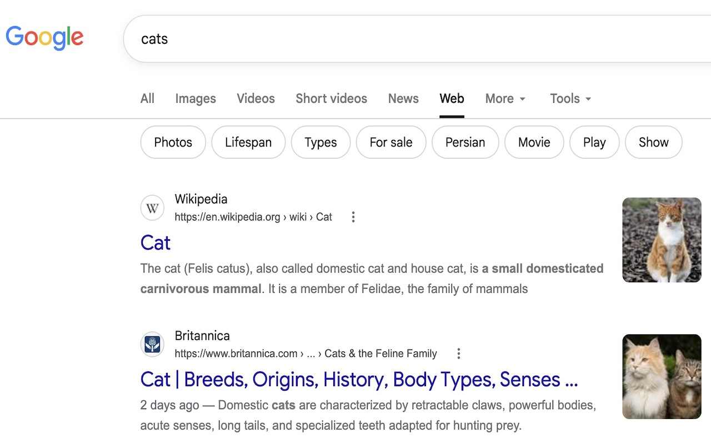

# Google Search AI Mode Remover

A lightweight Chrome Extension for school environments to automatically redirect users away from Google's "AI Mode" search and remove the relevant "AI Mode" button from the search toolbar.

## Downloading the Repository

To get a local copy of this extension up and running, follow these simple steps:

1. **Download the Code:**
   - Click the green `<> Code` button at the top right of this repository and select **Download ZIP**.
   - Alternatively, clone the repository via command line: `git clone https://github.com/Frankfurt-International-School/Gemibye.git`
2. **Extract the Files:** If you downloaded the ZIP, extract the folder to a memorable location on your computer.

## Uploading to the Chrome Web Store

If you are an administrator looking to distribute this extension via your Google Workspace or publicly on the Chrome Web Store, follow these steps to publish it:

### Preparation (Optional but Recommended)

Before packing your extension, you can customize it for your specific school or organization:

- **Update Extension Details:** Open the `manifest.json` file in any text editor. Modify the `"name"` and `"description"` fields to something recognizable for your users (e.g., "FIS PureResults").
- **Add Custom Icons:** Replace the default icons in the `images` folder with your own. You will need PNG images sized at 16x16, 32x32, 48x48, and 128x128 pixels. Ensure the file names match what is listed under the `"icons"` property in your `manifest.json`.

### Uploading and Publishing

1. **Zip the Extension:** Compress the `extension` folder (containing the `manifest.json`, `urls.js`, `elements.js`, and `images/*.png`) into a single `.zip` file.
2. **Register as a Developer:**
   - Go to the [Chrome Web Store Developer Dashboard](https://chrome.google.com/webstore/devconsole).
   - Sign in with your designated Google account.
   - Pay the one-time registration fee of $5 USD to activate your developer account.
3. **Upload the Item:**
   - In the Developer Dashboard, click the **+ New item** button.
   - Click **Select file**, select your `.zip` file and wait for it to upload.
4. **Complete the Listing Information:** You can use the examples in the `docs` folder if you do not wish to write your own.
   - **Store Listing:**
     - Description: `docs/description.txt`
     - Category: Education
     - Language: Choose your language (this does not have an impact)
     - Store Icon: `extension/images/icon-128.png` or your custom 128x128 icon
     - Screenshots: `docs/example.jpeg`
   - **Privacy:**
     - Single purpose: `docs/purpose.txt`
     - Permission justification: `docs/permissions.txt`
     - Data Usage: Deselect all options in the list of collected data types and certify the required disclosures.
     - Privacy policy: Not necessary as no data is collected.
   - **Distribution:**
     - Visibility: Select whether the extension will be publicly available, unlisted or private to your organisation.
       - Private distribution requires both settings in `Devices > Chrome > Apps & Extensions > User app settings > Chrome Web Store permissions` to be allowed in the OU that the developer account is in on Google Workspace Admin.
     - Distribution: Optionally only make it available in your organisation's country, or leave all selected.
5. **Submit for Review:** Once all required tabs are filled out, click **Save Draft** and when ready **Submit for review**.
   - Our review process took about 14 hours to be approved when set to be published privately for our organisation and only available in our organisations country.

### Deployment

Once your extension is approved and published, you can force install the extension using Google Workspace Admin to a specific OU with the following steps:

1. Login to [Google Workspace Admin](https://admin.google.com/)
2. Go to `Devices > Chrome > Apps & Extensions > Users & Browsers`
3. Choose the OU you want to apply the extension to
4. Click the yellow **+** button in the bottom right and then `Add from Chrome Web Store`
5. Find your extension either by searching or with it's ID (can be found in the [Chrome Web Store Developer Dashboard](https://chrome.google.com/webstore/devconsole))
6. Set the Installation Policy to either `Force Install` or `Force Install, allow users to disable` depending on your needs
